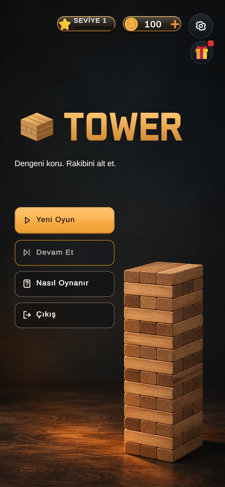
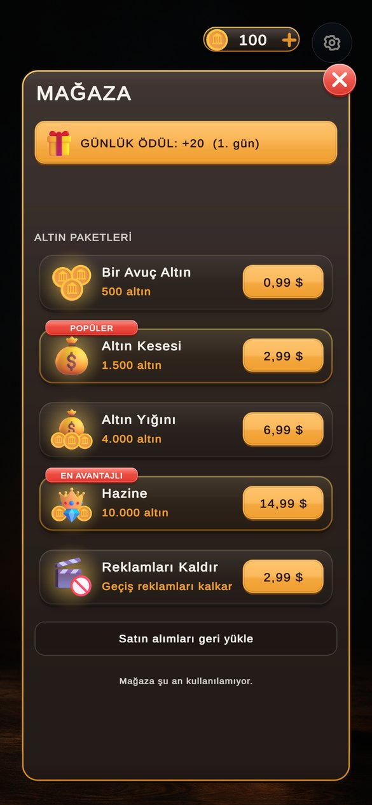
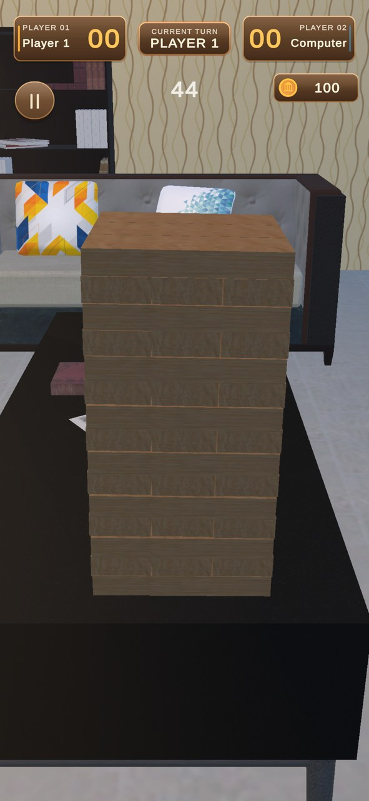
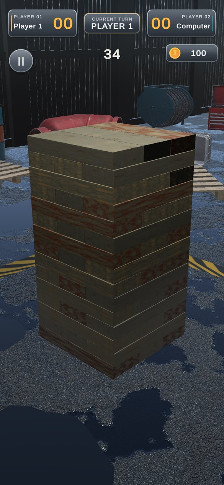
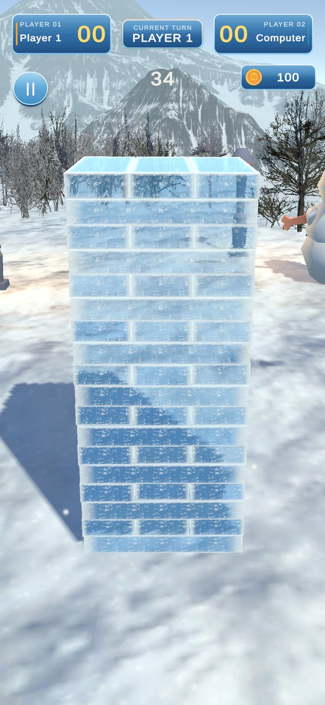
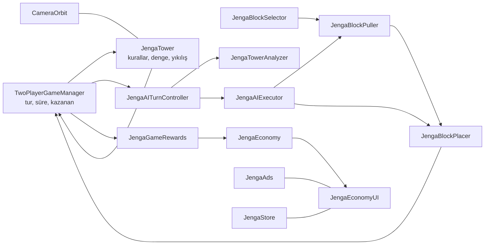

# Tower

Fizik tabanlı bir blok kulesi oyunu. Unity 6 ve URP ile geliştirildi; mobil öncelikli tasarlandı. Bilgisayara karşı tek oyunculu ya da aynı cihazda iki kişilik oynanır.

**[Tarayıcıda oyna](https://edaisikgoz99-ui.github.io/tower-game-presentation/)**

Demo sürümünde Klasik, Fabrika ve Buzul baştan açık. Mağaza ile reklam akışları test modunda çalışır.

| Ana menü | Mağaza | Klasik | Fabrika | Buzul |
|---|---|---|---|---|
|  |  |  |  |  |

[Klasik bölümün duraklatma ekranı](Docs/screenshots/klasik-duraklat.jpg)

## Öne çıkanlar

- **Üç ortam, üç malzeme.** Salon (ahşap), fabrika (paslı çelik) ve buzul (buz). Kamera ve kontrol mantığı aynıdır; fark yalnızca blokların kütlesi ve sürtünmesidir.
- **Kaybı fizik belirler.** Oyun, kule devrildiğinde ya da bir blok kuleden düştüğünde biter. Taş eğri ya da kayık konabilir; sonucunu denge belirler.
- **Risk ölçen yapay zekâ rakip.** Kuleyi analiz eder, aday taşları puanlar, çekiş sırasında denge payını, taşların eğimini ve hareketini izleyerek gerektiğinde bırakıp bekler; takıldığında başka taşla yeniden dener.
- **Dokunmatik kontrol.** Tek parmakla sürükleme, iki parmakla yükseklik ve döndürme. Taş yerleştirirken ana kamera eğimli bakar, köşedeki ikinci kamera taşın arka tarafını gösterir.
- **Yıkılış sinematiği.** Kule yıkılırken zaman yavaşlar, kamera yükselip geri çekilir; sonuç ekranı düşüş bittikten sonra gelir.
- **Prosedürel ses.** Ahşap sürtünme sesi, kayma hızına ve üstteki yüke göre gerçek zamanlı sentezlenir.
- **Özel URP gölgelendiricileri.** Kırılmalı buz bloğu, tavandan damlayan su, ışık hüzmesi.
- **İlerleme ve ekonomi.** Altın, deneyim puanı, seviye, 7 günlük giriş ödülü ve seviye ya da altınla açılan ortamlar.
- **Duyarlı arayüz.** Dikey ve yatay ekran, güvenli alan (çentik) desteği, her sahneye özel skor tahtası ve duraklatma menüsü teması.

## Teknik özet

| | |
|---|---|
| Motor | Unity 6000.5.8f1 |
| Görüntüleme | Universal Render Pipeline 17.5 |
| Dil | C# |
| Arayüz | uGUI + TextMeshPro |
| Girdi | Input System (dokunmatik, fare, klavye) |
| Hedefler | Android, iOS, WebGL |

## Proje yapısı

```
Assets/
  Scenes/            MainMenu, salon, fabrika, buzul
  Scripts/           JengaTower.Runtime derlemesi (ad alanı: JengaTower)
    Core/            Oyun yöneticisi (tur, süre, kazanan), girdi kapısı, blok kimliği ve geometri
    Tower/           Kule: kurulum, kurallar, denge ölçümü, yıkılış algısı
    Blocks/          Taş seçimi, çekme, yerleştirme, çekme oku
    AI/              Kule analizi, aday seçimi, hamle yürütme, zorluk ayarları
    Camera/          Kule merkezli yörünge kamerası, duvar koruması, kadraj hesabı
    UI/              Ana menü, skor tahtası, duraklatma, yerleştirme köşe kamerası
    Audio/           Ses efektleri, çarpma sesleri, sürtünme sentezi
    Economy/         Altın/XP/seviye, ödüller, mağaza ve reklam soyutlamaları, arayüz
    Environment/     Sahneye özel efektler (kıvılcım, ışık titremesi, zemin koruması)
    Platform/        Titreşim, ekran yönü kuralı
  Editor/            JengaTower.Editor derlemesi
    Build/           WebGL ve iOS derleme betikleri
    UI/              Menü, ekonomi arayüzü ve sahne teması kurucuları
  Shaders/           Özel URP gölgelendiricileri
  UI/                Menü görselleri, ekonomi ikonları, sahne temaları
  Resources/         Ekonomi ayarları, sesler, çalışma anında yüklenen varlıklar
```

## Mimari



- **Oyun akışı.** `TwoPlayerGameManager` sırayı, puanı ve hamle süresini (60 sn + 15 sn ek süre) yönetir. Kulenin olaylarını (`TowerCollapsed`, `BlockFallen`) ve yerleştirmenin bitişini dinler.
- **Kule.** `JengaTower` katları taşların etiketine değil o anki gerçek yüksekliğine göre belirler, denge payını (üstteki kütlenin ağırlık merkezi ile alttaki destek alanı) hesaplar ve kuleden ayrılan taşı algılar. Yeni el, oyun başında saklanan dokunulmamış kule kopyasından kurulur.
- **Oyuncu etkileşimi.** Seçim (`JengaBlockSelector`), çekme (`JengaBlockPuller`) ve yerleştirme (`JengaBlockPlacer`) ayrı bileşenlerdir. Arayüz düğmeleri ile oyun girdisi `JengaInputGate` üzerinden ayrışır.
- **Yapay zekâ.** `JengaAITurnController` bir durum makinesidir: kulenin durmasını bekler, analiz eder, aday üretir, seçer, hamleyi `JengaAIExecutor` ile yürütür. Başarısız denemede aynı taşı eler ve en fazla beş kez yeniden dener.
- **Ekonomi.** `JengaEconomy` altın, XP, seviye, günlük ödül ve ortam kilitlerini tutar; miktarlar `JengaEconomyConfig` varlığından gelir. Reklam ve ödeme, `IJengaAdProvider` ve `IJengaStoreProvider` arayüzlerinin arkasındadır; gerçek SDK bağlanana kadar editörde ve geliştirme derlemelerinde test penceresiyle çalışır.

## Oyun kuralları

- En üstteki tamamlanmış kattan ve onun üstünden taş çekilemez.
- Bir kat üç taşa tamamlanmadan üstüne taş konamaz; konursa taş oyuncunun eline geri verilir.
- Hizalama cezası yoktur. Oyunu yalnızca fizik bitirir: kule devrilir ya da bir taş kuleden düşer.
- Hamle süresi dolarsa sıradaki oyuncu kaybeder.

## Para kazanma tasarımı

Yerleşim kuralları Apple ve Google'ın yayımladığı politikalara göre kuruldu:

- Geçiş reklamı yalnızca oyun bittiği anda, sonuç ekranından önce gösterilir; açılışta, oyun sırasında ya da bir düğmeye basıldıktan sonra gösterilmez. İlk üç oyun reklamsızdır ve iki reklam arasında süre ve oyun sayısı sınırı vardır.
- Ödüllü reklam yalnızca oyuncu isterse açılır; kazanılacak ödül düğmenin üzerinde yazar.
- Altın yalnızca mağazanın kendi ödeme sistemiyle satılır, satın alınan altının süresi dolmaz ve kalıcı ürün için "satın alımları geri yükle" düğmesi vardır.
- Rastgele içerikli (sandık vb.) ücretli ürün yoktur.

**Durum:** reklam ve ödeme SDK'ları henüz bağlı değildir; akışlar test modunda çalışır ve gerçek para çekilmez. Oyun henüz mağazalarda yayımlanmamıştır.

## Lisans

Tower ve bu proje için hazırlanan görseller © 2026 Eda Işıkgöz. Tüm hakları saklıdır; ayrıntı için [LICENSE](LICENSE).

Üçüncü taraf varlıklar kendi lisanslarına tabidir: [THIRD_PARTY_NOTICES.md](THIRD_PARTY_NOTICES.md).
